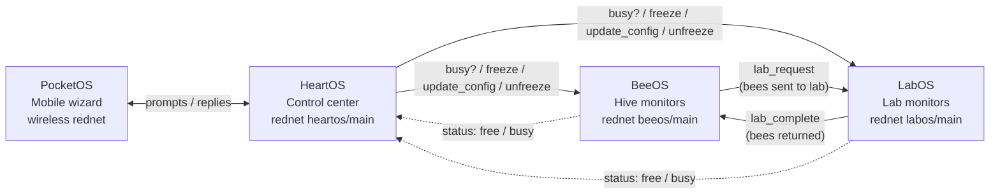

[English](README.md) | [Русский](README.ru.md) | [Docs](docs/)

```bash
wget run https://raw.githubusercontent.com/nikitroni/HiveOS/main/installer.lua
```

One command. The installer asks for a role (BeeOS / LabOS / HeartOS / PocketOS) and a branch (`main` or `upgrade`; Enter selects `main`). Choose `upgrade` only after that branch has been published.


# HiveOS

A ComputerCraft suite with three fixed terminals and a PocketOS controller for bees, genetics and hives in All the Mods 10.


## 🐝 What is HiveOS

HiveOS is a management layer for a bee farm built around a ComputerCraft network. It splits the work across three dedicated terminals instead of one overloaded computer: one terminal watches the hives, one runs the genetics lab, and one is the control center that writes and pushes configurations.

The system is designed for **All the Mods 10 (ATM10)** and its bee ecosystem (Productive Bees, Advanced Peripherals, Just Dire Things and friends), but the architecture is generic: all machine names come from configuration, and the heavy layout data lives in normal Lua tables, so the suite can be adapted to other modpacks with similar blocks.

Every terminal communicates over rednet with a small request/reply protocol, so you can place them anywhere in the base and rewire the farm by editing the config on the control terminal rather than editing scripts.

## 🖥️ Architecture

HiveOS is intentionally split into three roles. **HeartOS** is the control center: it owns the device registry (`device_types.lua`), validates and stores the config files, and talks to the other terminals. **BeeOS** owns the hive screens and the async reader that inspects every hive. **LabOS** owns the breeding and genetics pipeline plus four button monitors.

**PocketOS** runs on an Advanced Wireless Pocket Computer. It joins HeartOS over rednet, displays setup instructions, and sends wizard answers. HeartOS still scans nearby peripherals and saves the configurations. Pair the pocket computer with the code shown on the HeartOS monitor before using the wizard.

After pairing, choose `1–6` on PocketOS to create or edit BeeOS, LabOS, or the hive map. The pocket screen shows instructions and accepts replies. An unambiguous device is added automatically, and the completed configuration is confirmed once before saving. Notifications appear on PocketOS while it is online and fall back to the owner's private chat when it is offline. To pair a different pocket computer, stop HeartOS and run `heart_main --pair`.

Configuration changes follow the same pattern for BeeOS and LabOS. HeartOS first asks the terminal whether it is free (`busy?` / `status`); if the terminal is busy running a job it answers `wait` and the edit is refused. Otherwise HeartOS sends `freeze`, the terminal shows its wait screen, HeartOS pushes `update_config`, and finally sends `unfreeze`. Each step expects an explicit acknowledgement (`frozen`, `config_updated`, `running`).

To keep the user interface responsive, long-running work never touches the render loop. BeeOS reads hives through an asynchronous worker (`HiveReader`) that survives a hanging `getBlockData`, while LabOS runs breeding, gene production and upgrades in a separate task worker. Results are delivered as rednet events, so a stuck peripheral never freezes the screen.

A visual map of the network, including the bee hand-off from hive to lab, is shown below and expanded in [Systems Documentation](docs/systems.md).



## 📦 Requirements

- **All the Mods 10 (ATM10)** as the base modpack, or any modpack containing the mods listed below.
- **ComputerCraft: Tweaked** — the core of the project.
- **Advanced Peripherals** — additional peripheral devices.
- **Productive Bees** — BEES!!!
- **Just Dire Things** — breeding automation.
- **Modular Routers** — item routing around the lab.
- **Applied Energistics 2 (AE2)** — resource interface for supplying resources.
- **SuperFactoryManager (SFM)** or **Logistics Networks** — automation for large apiaries.
- **Ender IO** — gene crafters.
- **Item Collectors (or equivalent)** — drop collection and routing.

The three fixed terminals need **Wired Modems + Networking Cable** (advanced computers recommended). HeartOS also needs a **wireless or Ender Modem** to reach PocketOS. Equip the Advanced Wireless Pocket Computer with a modem upgrade. Use Ender Modems on both ends if you need unlimited range or communication across dimensions; regular wireless modems have limited range. The mod list may grow as the project is adapted to new packs.

## 🚀 Installation

1. Craft and place **three computers** with their monitors: one for HeartOS, one for BeeOS, one for LabOS.
2. Connect a **Wired Modem + Networking Cable** to each fixed terminal. Add a wireless or Ender Modem to HeartOS and equip the pocket computer with a matching wireless or Ender Modem.
3. On each computer run `wget run https://raw.githubusercontent.com/nikitroni/HiveOS/main/installer.lua`.
4. Pick a **role** (BeeOS / LabOS / HeartOS / PocketOS) and branch. Use the same branch on all four computers. The installer offers `main` by default; choose `upgrade` when testing a published upgrade branch.
5. Reboot BeeOS, LabOS, and HeartOS. Start PocketOS, enter the pairing code shown on the HeartOS monitor, then follow its setup prompts. HeartOS scans devices; PocketOS provides the controls and answers.

Full step-by-step instructions, including cable and monitor placement, are in [Setup Guide](docs/setup.md).

## 🔧 Key systems

- **Breeding** — LabOS drives a breeding chamber and an incubator through a fixed 3-cycle recipe, feeding sunflowers, cages and honey treats, then fires a Just Dire Things clicker to return the parents to the lab chest.
- **Hive map** — HeartOS renders a paginated grid of every hive (48 per page, in three layout groups of 16) with live status colors, and can pulse the relay of a selected hive so you can find it in the world.
- **Genetics** — LabOS reads genes from the indexer, tops up missing ones via a redstone relay, and upgrades bees in crafters + incubator until they reach the elite target values.

Details for all three systems are in [Systems Documentation](docs/systems.md).

## 📸 Screenshots

> Screenshots from the live setup.

**HeartOS control center** — Configure BeeOS / LabOS / Hive and the gene Library.


**BeeOS hive monitors** — the tech hive list and the compact info overview.


**LabOS breeding** — cycle progress and the upgrade log.


## 🗺️ Roadmap

- **v1.0** — three terminals, hive map, breeding, genetics, installer and configuration wizard (done).
- **v1.x** — flexible small quality-of-life improvements.
- **v2.0 (goal)** — a portable management terminal instead of chat, and a universal hive map that adapts to any layout.

The detailed roadmap is in [Roadmap](docs/roadmap.md).

## 📄 License

Released under the MIT License. See [MIT License](LICENSE).

## 🙏 Credits

- Built with [Kilo Code](https://kilo.ai).
- Designed for **All the Mods 10 (ATM10)**.
- Thanks to the authors of CC:Tweaked, Advanced Peripherals, Productive Bees, Just Dire Things, Modular Routers, AE2, SuperFactoryManager (SFM), Ender IO and Item Collectors.
